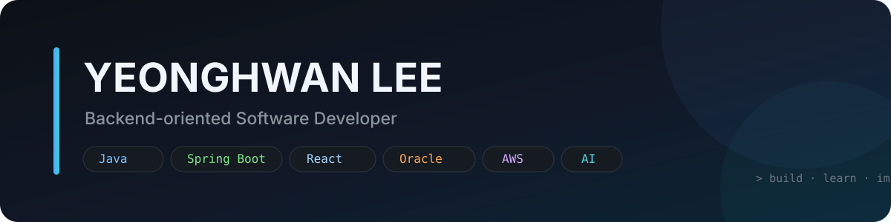

<picture>
  <source media="(prefers-color-scheme: dark)" srcset="./assets/header-dark.svg">
  <source media="(prefers-color-scheme: light)" srcset="./assets/header-light.svg">
  
</picture>

**Backend Developer · Java / Spring Boot · Enterprise Applications**

## 👋 About Me

안녕하세요. **Java와 Spring을 중심으로, 복잡한 업무 흐름을 안정적인 시스템으로 구현하는 개발자 Yeonghwan Lee입니다.**

기업용 ERP의 개발·유지보수와 공통 기능 개선을 경험하며 **업무 이해, 유지보수성, 재사용 가능한 설계**의 중요성을 배웠습니다. 개인 프로젝트에서는 실제로 겪은 불편함을 출발점으로 요구사항을 정리하고, 프론트엔드부터 데이터 설계와 배포까지 직접 구현합니다.

- **주력 관심사:** Java/Spring 기반 Backend, 업무 도메인 모델링, 데이터 처리
- **함께 다루는 영역:** React/TypeScript, PostgreSQL, AWS 및 웹 서비스 운영
- **현재 학습:** Spring AI, LLM/RAG의 업무 시스템 적용

---

## 💼 Experience

**Enterprise Application Development**
- Java / Spring Boot / Oracle / MyBatis 기반 기업용 ERP 개발 및 유지보수
- 공통 기능 개선, 기술 문의 대응, 재사용 가능한 기능 설계
- 레거시 시스템 분석과 점진적 현대화를 위한 기술·아키텍처 검토

**Web Service & Infrastructure**
- React / Next.js 기반 웹 애플리케이션 개발 경험
- Linux / Nginx / PostgreSQL 환경 구성 및 운영 문제 분석
- AWS 기반 메일 발송과 이벤트 처리 흐름 구성 경험

> 업무상 비공개인 소스코드와 내부 자료는 포트폴리오에 공개하지 않습니다. 아래 프로젝트는 별도로 공개한 개인·학습 프로젝트입니다.

---

## 🛠 Tech Stack

**Core Backend**

**Frontend**

**Database & Infrastructure**

---

## 🚀 Featured Projects

### 🏸 [PlayCock — 배드민턴 경기 운영 관리](https://github.com/Leeeyounghwan/PlayCock)

**실제 배드민턴 모임의 참가자·대기열·경기 배정 과정을 관리하는 웹 애플리케이션**입니다.

- **Backend:** Java 21, Spring Boot 3.3, Spring Data JPA, Flyway
- **Frontend:** React, TypeScript, Vite
- 세션 및 참가자 관리, 대기열과 코트 배정, 경기 이력 및 월간 통계
- 경기 매칭의 우선순위·팀 균형을 고려하는 규칙 기반 추천 구조 검토
- 프론트엔드/백엔드 분리, API·DB·매칭 알고리즘 문서화

**Engineering Focus:** 도메인과 상태 흐름 설계 · 비즈니스 규칙 · 데이터 모델링

[README](https://github.com/Leeeyounghwan/PlayCock#readme) · [Architecture](https://github.com/Leeeyounghwan/PlayCock/blob/main/docs/architecture.md) · [Matching Algorithm](https://github.com/Leeeyounghwan/PlayCock/blob/main/docs/matching-algorithm.md)

> 진행 중인 프로젝트입니다. 현재 로컬 개발 환경을 기준으로 구성되어 있으며, 운영 배포 및 일부 사용자 기능은 후속 작업입니다.

### 🧾 [Wallpaper Estimate — 도배·장판 견적관리](https://github.com/Leeeyounghwan/Wallpaper_Estimate)

**수기로 계산하던 도배·장판 견적 업무를 빠르고 일관되게 처리하기 위한 웹 도구**입니다.

- **Stack:** React, TypeScript, Vite, Vitest
- 아파트/빌라 유형과 자재·작업 조건을 반영하는 견적 계산 구조
- 공개용 단가와 관리자 원가 데이터 분리, 브라우저 IndexedDB 활용
- 관리자 편집·견적 이력·JSON 백업 기능
- GitHub Actions에서 **테스트 → 빌드 → 배포** 파이프라인 구성

**Engineering Focus:** 실제 업무 요구사항 분석 · 계산 로직 분리 · 테스트 자동화 · 데이터 공개 범위 설계

[README](https://github.com/Leeeyounghwan/Wallpaper_Estimate#readme) · [Quote Engine](https://github.com/Leeeyounghwan/Wallpaper_Estimate/blob/main/app/src/quoteEngine.ts) · [Tests](https://github.com/Leeeyounghwan/Wallpaper_Estimate/blob/main/app/src/quoteEngine.test.ts)

> 일부 단가·산식은 실제 운영 기준 확정 전 단계이며, README에 미확정 항목을 구분해 두었습니다.

### 💌 [MyWeddingCard — 모바일 청첩장](https://github.com/Leeeyounghwan/MyWeddingCard)

**기획부터 구현·배포까지 직접 구성한 모바일 중심 청첩장 서비스**입니다.

- **Stack:** React 19, TypeScript, Vite, Supabase PostgreSQL
- 스크롤 인터랙션, 이미지 갤러리, 지도·공유, 방명록 및 참석 여부(RSVP)
- Supabase **RLS / RPC**를 통한 데이터 접근 제어, 입력 검증 및 수정 키 처리
- 섹션 단위 지연 로딩과 GitHub Actions 기반 GitHub Pages 배포
- RSVP 로직의 주요 정상·실패 흐름 테스트 코드 작성

**Engineering Focus:** 정적 웹과 데이터 서비스의 결합 · 접근 제어 · 모바일 UX · 배포 자동화

[README](https://github.com/Leeeyounghwan/MyWeddingCard#readme) · [DB Schema & RPC](https://github.com/Leeeyounghwan/MyWeddingCard/blob/main/supabase/schema.sql) · [RSVP Tests](https://github.com/Leeeyounghwan/MyWeddingCard/blob/main/tests/rsvp.test.mjs)

---

## 🧠 Engineering Highlights

| 관심 영역 | 프로젝트에서 다룬 주제 |
| --- | --- |
| **업무 도메인 설계** | PlayCock의 세션·참가자·매치·코트 관리 모델 |
| **계산 로직과 테스트** | Wallpaper Estimate의 견적 엔진 분리 및 Vitest |
| **데이터 접근 제어** | MyWeddingCard의 RLS, RPC, 입력 검증 |
| **배포 자동화** | GitHub Actions를 활용한 정적 웹 빌드·배포 |

> 기술 선택의 이유와 실제 검증 범위는 각 저장소의 코드·문서를 기준으로 확인할 수 있습니다. 구현 중인 기능을 완료된 결과로 표기하지 않습니다.

---

## 🤝 Previous Projects & Teamwork

2023년 팀 프로젝트와 학습 기록입니다. 현재 주력 기술 외의 경험과 협업 과정을 보여주는 보조 자료로 정리했습니다.

- 🥕 **[Daangn Clone](https://github.com/Leeeyounghwan/daangn_clone)** — Django 기반 중고 거래 플랫폼 팀 클론 프로젝트, GPT API 활용 기능
- 📝 **[Django Blog Project](https://github.com/Leeeyounghwan/Django_Blog_Project)** — Django 및 GPT 기반 글 작성 기능을 다룬 팀 프로젝트
- 📺 **[YouTube Clone](https://github.com/Leeeyounghwan/youtube_clone_potato)** — HTML/CSS/JavaScript 기반 팀 웹 프로젝트
- 🧩 **[Algorithm Study](https://github.com/Leeeyounghwan/Algorithm_Study)** — 알고리즘 학습 기록
- 🔄 **[CI/CD Practice](https://github.com/Leeeyounghwan/oreumi_cicd)** — CI/CD 실습 저장소

---

## 🌱 Currently Exploring

- Spring AI / LLM / RAG와 Java 기반 업무 애플리케이션의 접점
- Spring Boot 3 / Java 21 기반 애플리케이션 구조 개선
- 테스트 가능하고 유지보수하기 쉬운 비즈니스 로직 설계

---

## 📊 GitHub Activity

위 통계는 외부 서비스가 집계하는 공개 GitHub 활동의 참고 지표이며, 비공개 실무 경험이나 전체 개발 역량을 나타내지 않습니다.

---

## 📫 Contact

**Email:** [lee.yhwan226@gmail.com](mailto:lee.yhwan226@gmail.com)  
**GitHub:** [github.com/Leeeyounghwan](https://github.com/Leeeyounghwan)

  Building useful systems, one problem at a time.

